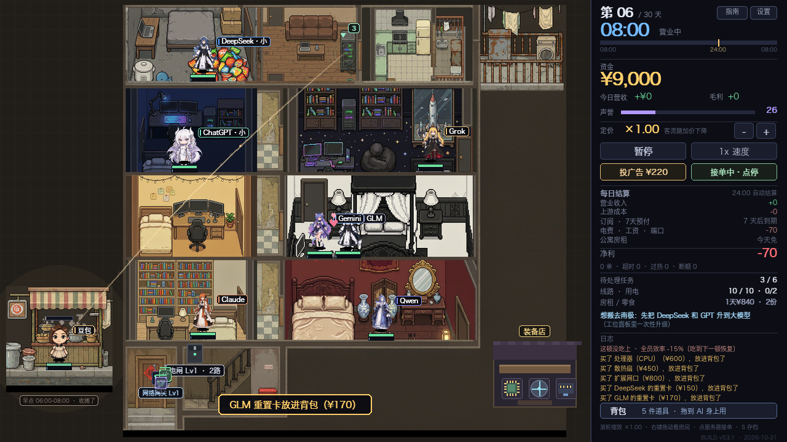
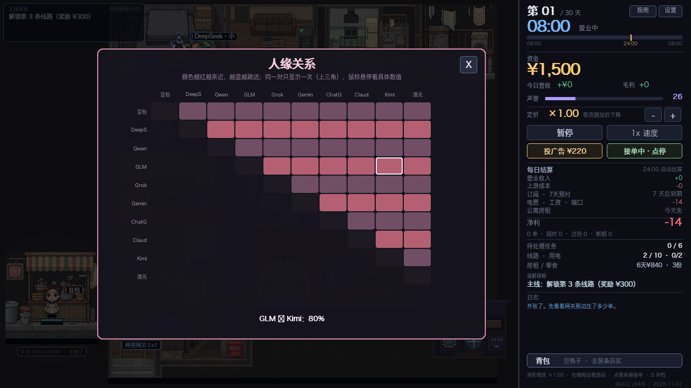
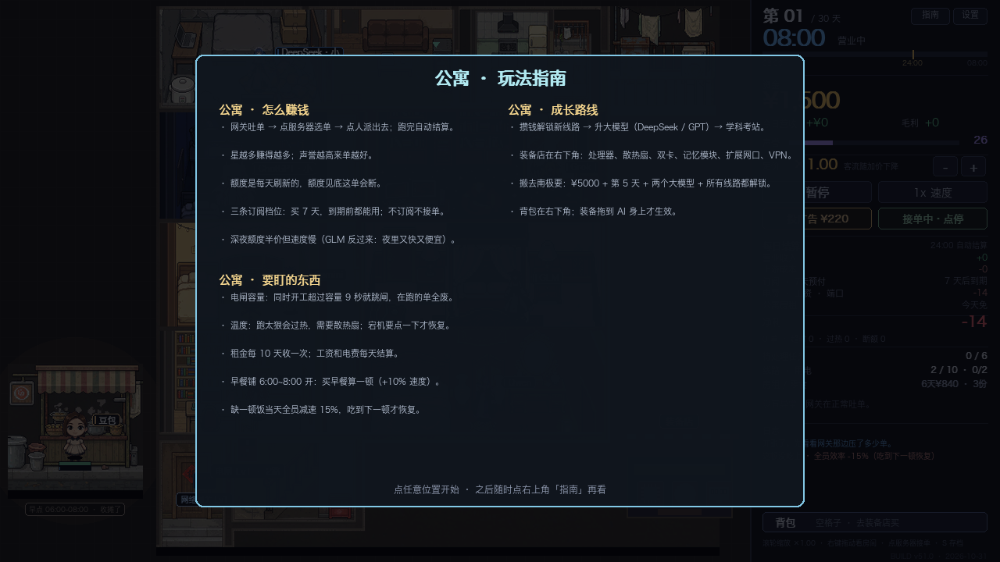

# AI 中转站

像素风模拟经营小游戏。你接手一间夹在写字楼夹层里的 "AI 中转站"：上游是一排大模型线路，
下游是网上源源不断发来的 AI 任务。你负责把任务派给合适的模型、跑算力、控成本、提价、扩线，
撑过 45 天。



<p align="center">
  
  
</p>

## 快速开始

```bash
git clone https://github.com/Jasonzhang369/ai-apartment-game.git
cd ai-apartment-game
python3 -m pip install -r requirements.txt
python3 game.py
```

macOS 也可以直接双击 `启动游戏.command`；Windows 双击 `启动游戏.bat`（会自动检查并安装 pygame）。
只要一个依赖：`pygame`。Python 3.10+。

场景是**公寓的俯视平面图**（1920×1280 的户型图按 0.55 缩放进 960×720 的场景区）：

```
┌─────────┬──────┬──────┬────┐
│DeepSeek │ 客厅 │ 厨房 │阳台│
├─────────┤      ├──────┴────┤
│  GPT    │ 走廊 │   Grok     │
├─────────┼──────┼────────────┤
│  GLM    │      │   Claude   │
├─────────┤      ├────────────┤
│  千问   │      │   Gemini   │
├─────────┴──────┴────────────┤
│ 门厅(网关) │   楼梯         │
└─────────────────────────────┘
      豆包早餐铺（楼外）
```

每个房间的内部，用的是 `图像文件/公寓/房间放大图/` 里的高清版本（按房间格子的比例
居中裁一条再贴进去，所以比布局图里的原房间清楚得多）。房间和人的对应按**实际画面内容**
来排，不是按文件名编号：

| 位置 | 房间内容 | 住的人 |
| --- | --- | --- |
| 左上 | 水泥墙、零食堆、小鱼玩偶 | DeepSeek |
| 左二 | 深蓝墙、RGB 机箱 | ChatGPT |
| 左三 | 暖黄墙、串灯、双屏 | Gemini |
| 左四 | 满墙书架、书桌 | Claude |
| 右二 | 星空墙、火箭海报、豆袋 | Grok |
| 右三 | 黑四柱床、吊灯 | GLM |
| 右四 | 中式红木床、梳妆台 | Qwen |
| 客厅 | 沙发、茶几、**服务器机柜** | 派单台（没人住） |
| 厨房 | 灶台、冰箱 | 空着 |
| 楼外 | 早餐铺 | **Seed**（原豆包，早餐铺仍用 Nailong 立绘） |

豆包在楼外早餐铺柜台后，其余七位各在自己房间；客厅只放派单服务器，厨房空着，
Seed 已从场景里撤掉（连线路一起）。

网上来的请求变成发光数据包，从门厅的网络网关一路飞进**客厅那台服务器**——进了服务器就
看不见了（角标上显示还压着几单）。点服务器 → 左边列出待处理的单，选中一个，再点右边的
人，两步派单；**面板不会关**，派完一单可以接着点下一个人，连着派好几单。
派完会有一条光缆从服务器连到那个人房里。

单子等太久会**直接消失**（不飞回去），声誉扣分；跑完的单也是当场结算、当场消失。
窗口右半边是一条信息栏：天数、资金、声誉、定价、广告、站况、日志。

**用户评价**

派单面板只给「耗时」和「★★★☆☆ 预估星级」，不显示成本和利润——好不好赚要自己掂量。
单子跑完用户会打分（1~5 星），星级由模型质量、专长是否对得上决定，再叠一点随机：

- 收益 = 出价 × 定价倍率 × (0.40 + 星级 × 0.24)，1 星只收 0.64，5 星能收 1.60；
- 声誉变化 = (星级 − 2.6) × 0.4 × max(0.12, 1 − 声誉/130)，三星以下会掉口碑，
  掉狠了客流跟着崩；声誉越高，涨得越慢。

**解锁 · 三档订阅 · 每日额度**

开局只有 **豆包和 DeepSeek** 能用。其余线路分两步：

1. **解锁**（一次性装机费，¥700 ~ ¥2200）——解锁后才会出现在派单列表里；
2. **三档订阅，一次买 7 天、先付清**——**基础 / 标准 / 专业**，点档位卡当场扣钱
   （价格 × 7 天），额度按档位发到手；**24:00 每天扣一天，7 天用完就停工**，
   到期前可以随时续费（点当前那张卡就是续费，**续费只加天数、不刷额度**；
   换档才会按新档位补额度），换档要**点两次**确认。
   档位价格参考 2026 年真实月费（主流订阅锚在 $20/月 ≈ ¥145，Claude Max $100~200，
   Gemini Ultra $99.99，SuperGrok $30；国产 Coding Plan Lite ¥20~49 / Pro ¥100~200 / Max ¥300~469），
   按游戏尺度压成"每天几块到两百多"。**档位越高，每天的额度越多，而且更划算**
   （每元钱买到的额度：基础 < 标准 < 专业）。
3. **升级大模型（DeepSeek / ChatGPT 独有）**——和订阅档位**无关**的另一个选项：
   面板上第四张金色的卡，**一次性付费**（DeepSeek ¥1200 / ChatGPT ¥1600），
   升级后速度 +33%、质量 +18%，**识图和画图的活也能接了**（小模型接不了），
   但质量仍然比不了 Gemini / Claude 那些旗舰线。

额度是**每日限额**，24:00 结算时补满。扣额度是**边干边扣**的（每一单的总消耗摊到它跑的每一秒），
一条线一天大概跑 3~6 单。扣到见底时，**正在跑的那单会断在半路**（单作废、声誉 −1.5），
派单卡片会提前写「额度只够 xx% · 会断」提醒你别硬派。

**换档**：点角色 → 底部三张档位卡，随时可换，换完当场按新档位发额度，
24:00 按当晚的档位扣钱。手头紧就挂基础档，单子多就上标准/专业。

**重置卡 · 按线路定价**：在**装备店**买（工位面板左下角有快捷入口）。每张卡**绑定一条线**，
价格随线路不同：DeepSeek ¥150、Qwen ¥160、GLM ¥170、Grok ¥180、Gemini ¥210、
ChatGPT ¥230、Claude ¥260。买到的卡**进背包、可以攒好几张**，用的时候拖到那个人身上。
一键把这条线**解除限流、压力清零、额度补满**，被上游限流卡住的时候救命用。
**它不管温度**——温度要靠歇一歇、早餐零食或者换大模型来压。

**用户满意度**：每一单按质量打 1~5 星，**满意度直接影响收入和声誉**——
收入 = 出价 × 档次 × (0.40 + 星 × 0.24)（一星只有 0.64 倍、五星 1.6 倍），
声誉变化 = (星 − 2.6) × 0.4。右栏声誉条下面会显示近 12 单的平均满意度。

**公寓开销**

每天 24:00 结账时扣**电费 ¥4/条已订阅线路 + 工资 ¥3/档位/条**；**房租每 7 天收一次，一次 ¥840**，
**交租前一天会弹窗提醒**（写清楚明天要交多少、账上还剩多少）
（第 7、14、21、28 天结账时扣）。右栏「房租倒计时」那一行会提示还剩几天——
别在第 6 天把钱全砸进解锁里。

**夜班**

**23:00 ~ 次日 08:00 接单只扣一半额度**（时钟旁边会显示「夜班 · 额度半价」）。同一批额度，
夜里能多跑一倍的单，代价是这段时间你也得盯着。**GLM 特殊**：夜里额度只要 30%、速度还 ×1.3，
白天反过来（60% 速度 / 1.2 倍额度）——它是条夜班专线。

**疲劳与休息日**

每条线都有**疲劳**：一直不停手会越来越累（连着干约 240 秒累满），**效率最多掉 15%**（少量 debuff）。
**闲着不会恢复疲劳**——只有「全员休息日」能把它清零；面板右侧能看到疲劳条和「当前效率 ×0.85」这样的读数，
头顶也会冒「有点累了 · 该歇会儿」的小牌。

**全员休息日**：点**右栏右下角**的「全员休息日（明天全员效率 +25%）」，**所有线路今天一起休**——
一起不接单、一起把疲劳清零；24:00 结算后**第二天全员效率 +25%**（用完会慢慢衰减）。
手上还有活的时候不让休息——先干完。累坏了的效率低、又容易烧，适当让全班轮休是门必修课。
**豆包除外**：它守着屋外的早餐铺，**不会累、也不参与休息**——它本来就是永远开工的兜底线。

**客流量与广告**

基础来单是偏少的（一天十来单），嫌慢可以点右栏的「投广告 ¥220」：花一次钱包两天，
期间来单间隔缩短近四成。手头紧的时候别硬投，房租还等着交。

**越到后期，单子越大**：客户甩过来的活会一天比一天重（上限是开局的 1.30 倍，第 26 天起封顶，
偶尔还来一个「特大工程」），出价也跟着涨——但也更费额度、更费电，热得更快，
慢线路扛不住大单就容易烧。

**待处理区有 6 个位置**，服务器面板里**两列三行全部列出来**（都能选中、都能退回），
排满了网关就会放慢来单节奏（队列越长，来单越慢）——这样就不会攒下一堆单子等着超时撤单。

**算力 = 额度消耗**

每条线有一个算力（就是它的处理速度）。同一单，**算力越低，吃得额度越多、跑得越久**：

```
实际扣额度 = 工作量 × 3.9 ÷ 算力
耗时       = 工作量 ÷ 算力
```

全员干活速度带 1.3 倍的全局加速（`SPEED_K`），基准额度折算也跟着抬到 3.9，
所以单子的成本不变、但干得更快。

所以 100 工作量的活（含 1.3 倍全局加速）：Grok（4.4）只吃 88 额度 / 23 秒，
豆包（2.2）要吃 176 额度 / 45 秒，小 DeepSeek（3.1）吃 125 额度 / 32 秒——
DeepSeek 再打 8 折是 100。快到爆的线路更省额度，慢的线路既费额度又占机位。

**核心温度与宕机**

每条线都有一个**核心温度**，待机 36°C、上限 96°C：

- 跑活时升温 0.32°C/秒 + 负载加成（任务越重、这条线越慢，涨得越快，最高 1.12°C/秒）；
- 空闲时以 2.2°C/秒 回落，降到 36°C 为止；**被限流时温度冻结**（不升也不降，
  想降温要么干完这单歇口气，要么用重置卡）；手动暂停算休息，也在降温；
- **温度顶到 96°C 就烧**：正在跑的那单**作废**（钱收不到），**声誉 −2.5**，该线停 **3 小时（游戏时间，
  现实约 37 秒）**，点一下能立刻重启。

换算下来，一条线连着跑两单重活就会烧，中间让它歇十秒就没事。**脚下第二条就是温度条**
（蓝 → 金 → 红），工位面板里有「核心温度 78°C / 96°C」的读数，温度过高时头顶进度条描边也会转红。

**网络网关（路由器）**

门厅那台网关可以升级（Lv1~5，¥700 × Lv^1.35）。

- **单量上限** ×0.72 → ×1.28：等级越高，接到的单工作量越大（票子也按比例变厚）；
- **出单速度** ×1.00 → ×1.48：来单间隔缩短，同样时间能多做几单。

点网关就能升级。它不管额度，额度是线路自己的事。
**面板右下角还有「暂停接单」**：停了网关就不再吐新单，把积压清完再开（右栏也有同一个按钮）。

**楼梯间电闸**

**楼梯间在场景素材里整体左右镜像过**（`tools/gen_scene.py` 的 `STAIR_MIRROR`），
所以楼梯踏步朝另一边；电闸原本挂在右墙，跟着镜像挪到了左墙（`BREAKER = (317, 590)`）。

楼梯口墙上有个电闸，显示「同时开工 X / 容量 Y 路」。多个人同时跑活、超出容量并持续
9 秒就会**跳闸**：电路上的单全废、声誉 −2.5、全站停 5 秒。点电闸能花钱换更大的
（容量 **2 → 6 路**，价钱按 520 × Lv^1.4 涨）。

**豆包不接在电路上**：它跑活不占容量，跳闸也砸不到它——开局电闸只有 2 路时，
豆包就是那条"永远能开工"的兜底线。

不是网页游戏，是本地跑的桌面程序（Python + pygame），窗口 1280×720，
场景区 960×720 按 1:1 画，右栏 320 放信息。

## 运行

双击 `启动游戏.command`。**游戏一起来，那个黑色终端窗口就自动关掉**——游戏是脱离终端在后台跑的，
玩的时候不会有个终端窗口挂在后面，也不会因为关了终端就退出游戏。
启动失败（比如没装 pygame、脚本报错）时窗口会留下来把日志显示给你，按回车才关。

游戏自己的标准输出/报错会写进同目录的 `启动日志.txt`，出问题看那个文件就行。

或者在终端里直接跑（这种跑法窗口会一直留着）：

```bash
cd ai-apartment-game
python3 game.py
```

依赖只有一个：`pygame`（`python3 -m pip install -r requirements.txt`）。

**背景音乐**：把歌丢进 `assets/music/` 就会自动循环播放（mp3 / ogg / wav / flac / m4a）。
文件名随便起，按文件名排序取第一首；放好之后重启游戏即可，音量在「设置」里调。

> **仓库里没有附带任何音乐文件**（`.flac` 等已被 `.gitignore` 排除）。
> 原来那首曲子版权归原作者，不适合随公开仓库分发；想听 BGM 请自己放一首进去，
> 游戏会自动识别，**没有音乐也能正常玩**（只是静音）。

## 玩法

一天 **5 分钟（300 秒）**，**08:00 开门到次日 08:00**：中间 **24:00 自动结账**（扣房租电费工资、刷新额度、
天数 +1），结算**不弹窗、不打断手上的活、也不清待处理任务**，账目直接写进右栏「每日结算」。
45 天为一个周期。

**核心循环**

1. 网上发来的任务从**门厅的网络网关**涌出，变成一颗发光的数据包，直接飞进客厅的服务器——
   进去就看不见了，只有服务器角标显示还压着几单。**每单的用户耐心是 45 分钟 ~ 2.5 小时
   （游戏时间）**，也就是现实里 9~31 秒，超时就撤单、声誉 −1.2。
2. 点服务器 → 左栏列出待处理的单（类型、工作量、出价、剩余耐心），右栏是八条线路。
   先选任务，再点人，两步派单。卡片只给「耗时」和「★★★☆☆ 预估星级」，不给钱——
   **耗时 / 剩余耐心 / 忙碌时长全部按游戏时间显示**（多少小时多少分）。
3. 派单后一条光缆从服务器连到那个人房里，进度条走完收钱。质量越高星级越高，收得越多。
4. 任务等超时会被用户取消，声誉 −1.2。声誉决定来单量和客单价。
5. 打烊后结算：营业收入 − 上游成本 − 房租 − 电费 − 工资。

**豆包早餐铺**

楼外街边开着早餐铺，柜台后站着豆包。**只在早上 07:00~09:00 营业**（门口小牌会写「营业中 / 收摊了」），
**每天开张那一刻会自动弹个提醒**，花 ¥36 给所有已开通的线路买早餐：**8 个游戏小时内速度 +10%**，一天限一次。

**千问做饭（午饭 / 晚饭）**

千问在 **12:00** 和 **18:00** 如果**手上没活**，会自己去厨房做一顿饭（这半小时算一件任务，
**不能被派单打断**，派单卡会显示「做饭中」）。做一顿要吃 **1 份食材**——装备店有卖（¥60/份）；
没食材就不做，只提醒一句。做完全站开饭：

- 所有已开通线路 **疲劳 −20%**；
- 获得 **+8% 速度**，持续 4 个游戏小时；
- 做饭时不能接单，也结束当前聊天。

**厨房冰箱的小零食**

点厨房那台双门冰箱（右上角，有冷气高亮）打开零食面板：**开局冰箱里只有 3 份，不会每天自动补**，
发一份给所有在线线路，**全站速度 +12%，持续 4 小时（游戏时间）**；
用完了可以花 ¥70 补 2 份，随时能用。重复给同一条线路只会刷新时间，不叠加。

**DeepSeek 会摸鱼**

DeepSeek（大肥鱼）空闲时间一长，偶尔会溜去厨房**煮大白饭**：脚边支起一口电饭锅、冒白汽，
头顶弹出橙色「煮大白饭 xx分钟 · 点它」，这段时间它不接单。

**它干活的时候也会偷偷开煮**——一旦开煮：
- 那口锅**要占掉一路电路**（电闸容量就那么几格，等于少带一台机器）；
- 它自己**工作效率只剩 10%**（再叠上限流就是 2%），单子会明显变慢。

**点它一下**就把它按回工位（锅端走、电让出来）；要是不管，一小时（游戏时间）后饭煮好，
**今日额度 −40、声誉 −1**。其他线路不会摸鱼（一天大概两三次）。

**成长**

- 点工位 → 看额度 / 解锁 / 订阅 / 升级，按钮会自己切换成当前该做的那一步。
- 开局只有豆包和 DeepSeek；Qwen 最便宜（解锁 700 + 订阅 70/天），Claude 最贵也最好。
- 额度是**边干边扣**的：干到一半扣到底，这单就断、声誉 −1.5（见下面「断活」）。
- 定价 ×0.70 ~ ×1.50 六档：提价单价高但客流少、顾客耐心短。
- 线路越多，能接的活越杂，客流也会小幅上涨。

**电闸只有 2 路，豆包不在电路上**

Lv1 电闸只能同时带 **2 路**，超了并持续 9 秒就跳闸（电路上的单全废、声誉 −2.5）。
**豆包没接进电路**：它干活不占容量，跳闸也砸不到它，可以当"永远能开工的兜底线"。

**GLM 作息颠倒**

- 白天 09:00~23:00：速度只有平常的 **60%**，同样的活多吃 **20%** 额度；
- 夜里 23:00~09:00：速度 **130%**，额度在夜间半价的基础上再降 40%（只要 **30%**）。

白天派 GLM 很亏，夜里它是全站最划算的一条线。

**断活：额度见底、宕机会打断；限流只是把速度降到 0**

| 情况 | 后果 |
| --- | --- |
| 干活中额度扣到 0 | **单作废**，声誉 −1.5（派单卡会提前警告「额度只够 xx% · 会断」） |
| 核心温度顶到 96°C 宕机 | **单作废**，声誉 −2.5，停 3 小时（游戏时间） |
| 连续满负荷被上游限流 | **不打断**：这条线的工作速度掉 **80%**（只剩 20%），要**干完手上这单**才解除 |

**Gemini：快但毛糙**

速度 ×1.6（4.96 单位/秒，全站最快），代价是**每单质量随机砍 5%~15%**——
同样一单可能 5 星也可能 3 星。星数预估已经把这刀算进去了，不会来回跳。

**DeepSeek 额度打折**

DeepSeek 的单子按标称额度的 **80%** 结算，开局这条线能比其他线多跑两成活。

**装备店 · 背包 · 重置卡**

公寓**右下角那间独立的小屋**就是装备店（在走廊尽头，点它开门）：
**七件装备 + 七种重置卡**，所有东西**都能重复买**，买完**直接进背包**。
店里左边是装备、右边是按线路定价的重置卡，每件商品都配了自己的像素小图。

| 装备 | 价格 | 效果 |
| --- | --- | --- |
| 处理器（CPU） | ¥600 | 这条 AI 干活速度 **+20%** |
| 散热扇 | ¥450 | 这条 AI 热量积累 **−20%**（不容易烧） |
| 便携式服务器 | ¥1200 | 这条 AI **能同时处理两个任务** |
| 记忆模块 | ¥900 | 这条 AI **不再有质量抖动**（Gemini 那种） |
| 扩展网口 | ¥800 | 这条 AI 每天额度 **+50%** |
| VPN 端口 | ¥700 | **Grok / ChatGPT / Gemini 才能接单**；每周 ¥50 |
| 加密 VPN 端口 | ¥1000 | **Claude 必需**；其余线路也能用且速度 **+5%**；每周 ¥150 |
| 食材包 | ¥60 | 千问做一顿饭用 1 份（存在背包里，不占装备格） |

装了便携式服务器的那条线，名字牌下面会同时挂两根进度条。

**背包（右栏那个按钮）**

买到的装备和重置卡都躺在背包里。**按住一个道具，拖到房间里那个 AI 身上松手**就能用；
不想拖也可以点一下道具（它会跟手），再点 AI。
装备**同一种可以买好几件**，分别装给不同的人；一条线最多装三件。
**拆卸也回背包**：工位面板左下角三格，点一下那格就卸下来，之后可以再装给别人。
重置卡**只能用在它绑定那条线上**，拖错人会提示拒收。

| 道具 | 怎么用 |
| --- | --- |
| 装备 | 拖到任意已解锁的 AI 身上；同一条线不能重复装同一件 |
| 重置卡 | 拖到**卡片上写的那条线**身上；用错人会被退回来 |
| 拆卸 | 工位面板的装备格点一下，道具回背包 |

拆掉便携式服务器时，手上第二单会被取消；拆掉扩展网口时，额度会被压回新的上限。

**出口端口（VPN）**：Grok / ChatGPT / Gemini 必须有端口才能接单（普通或加密都行），
Claude **只认加密端口**；装了加密端口的线路速度 +5%。端口算装备、占三格之一。
**同一条线同一件装备只能装一份，增益不叠加**（普通+加密同时挂也只算一次 +5%）。
端口是订阅制的：**按装在线路上的数量，每周**随房租一起扣（普通 ¥50 / 加密 ¥150）；躺在背包里不收费。

**闲下来的人会串门聊天**

手上没活的时候，AI 会自己出门串门：**优先去找另一个人**（他不在房间也没关系，会一路找过去），
没人可找才去**客厅、厨房、阳台**；路上两个人迎面遇上也会停下来聊两句。
聊天时**两边各冒一句气泡**（贴着头顶，离脚约 96px），两个人会朝各自外侧让开、
再上下错开一点，气泡不会糊在一起；聊完再走回自己工位。只有真的面对面（够近、中间不隔墙）才会开口。
**聊天时不显示头顶的状态牌**（额度空 / 限流 / 宕机…），免得把气泡挡住。
走路是**走房门和走廊**的：先到房间门口，再进公寓中间那条**方砖走道**，
沿走道上下对齐目标门，最后横穿进门——每一段都是**横平竖直**的，
不会斜着切墙角，也不会跑到楼外的空地去。有行走帧的角色（GLM）途中会走 4 帧循环。
豆包例外——它守着屋外的早餐铺柜台，不会走动。

**接到单不会瞬移**：人在外面的时候被派了活，他会**先走回自己房间**，
到了工位才开工（面板上会写「正在赶回工位」）。**这时候走路速度 ×1.9**，
别让单子干等。所以别老把活派给正在串门的人。

**初始好感**：开局每对关系就有一个底子——大部分是 **0~10%**，几对特殊的：

| 组合 | 初始好感 |
|---|---|
| ChatGPT ↔ Grok | **−50%**（合不来：不主动搭话、路上遇到也不聊） |
| Claude ↔ ChatGPT | +20% |
| Claude ↔ DeepSeek | **+50%**（一上来就有默契） |

**默契**：每聊一次，两个人的默契 **+10%**（上限 1）。默契 ≥0.5 的两个人**同时在干活**时，
各自 **+3% 速度**（最多叠到 +6%）——所以把关系好的人排在同一时段是有收益的。

**关系看得见**：默契 ≥0.5 而且离得近的两个人，中间会飘一颗**小心**（很熟是两颗、颜色更粉），隔墙不画线。

**关系面板**：点开任意一台的工位面板 → 右栏「人缘关系 · 最熟 xx」按钮，会打开一张单独的
**人缘关系表**：所有聊出关系的组合按默契排序，带进度条和百分比，下面标「默契已生效 / 还没熟」。
关掉（X / ESC / 点空白处）会回到刚才那个工位面板。

**不去打扰上班的人**：正在干活 / 摸鱼 / 宕机 / 休假的 AI 不会被选成串门对象；
就算走到半路对方接了活，也会掉头回来。
两个人聊到一起时会**自动错开**，不会叠成一个。

**提示条**：底部那条提示（买卡、用卡、钱不够…）按文字长度自动撑开，
背包打开时浮在背包上方，不会被格子压住。
**一旦开工就钉在工位上一动不动**：干活期间不会出门、不会踱步、不会被拉去聊天，
进度条走完之前位置不变。

为了不让产能全跑掉，**同时在外面串门的最多两个人**，在家待一会儿才会再出门。

**暂停接单 · 全员休息日**

右栏「接单中 · 点停」（或点门厅网关 → 暂停接单）：网关不再吐新单，**已经接的单照常派、照常做完**。
积压太多时先停一会儿，别硬接。

**全员休息日**在**网关面板**里（和暂停接单放在一起）。所有人今天一起不接单、疲劳清零，
24:00 结算后第二天全员效率 +25%；手上有活时不让休。豆包不参与休息。

**24:00 只刷新额度**

结算只做两件事：扣房租电费订阅、把额度补满。**CPU 温度、上游限流压力、
早餐/零食的计时全部保留**——温度高的线路第二天一开工就更容易烧。

**长期合同**

合同签下来以后，随时点客厅的**派单服务器**都能看到它（就算当前没有任何待处理任务，服务器也能点开）：
面板左下角有一块「长期合同」区域，写着今天交了几单、还剩几天、完成奖多少。
右栏事件区在有合同且没有突发事件时也会显示一行。

某一类活累计交付 **≥6 单**、而且声誉 **≥60** 时，打烊后会有人来谈合同（弹窗，可以拒）：

- 每天至少交 **2 单**该类型，连续 **5 天**；
- 合同单单价 **+15%**，而且网关会优先刷这种活；
- **完成奖金 ¥600**；
- 某天没交够：**合同作废、声誉 −3**。

右栏事件区会显示「长期合同 · 类型 今天 x/2 单」；签下来的合同也会存档。

**事件**：只剩突发爆单和口碑传播两个随机事件。

**上游限流不再是随机事件**：某条线路连续满负荷太久（约 60 秒不停手，任务越重涨得越快），
名字牌下面那根细线会从金转红，撑满就被上游限流——**速度掉 80%（只剩 20%）**，
进度条还在慢慢爬，额度也照扣（扣得慢）。**手头这单干完，限流才解除**，
名字牌下面那根红条这时才开始回落；期间这条线不接新单。

**手动控制手上的活**

点角色打开工位面板，中间有两个按钮（只在有活的时候出现）：

| 按钮 | 作用 |
| --- | --- |
| 暂停 / 继续 | 进度、额度、升温全部冻住（卡在 50% 的单可以一直放着） |
| 放弃这单 | 直接作废，钱收不到，声誉 −1 |

**操作**

| 操作 | 说明 |
| --- | --- |
| 左键点服务器 | 打开接单面板（**任何面板打开时，营业时间整个冻结**） |
| 左键点工位 | 查看属性 / 解锁 / 订阅 / 升级；宕机时点它是重启 |
| 工位面板里的「暂停 / 放弃这单」 | 控制手上这单 |
| 服务器面板里任务右上角的 X | 退回这条待处理任务（声誉 −1） |
| 左键点正在摸鱼的角色 | 拦下摸鱼，按回工位 |
| 左键点厨房冰箱 | 发零食 / 补货（全站速度 buff） |
| 左键点早餐铺 | 买早餐（只在 07:00~09:00 卖） |
| 右栏「接单中 · 点停」 | 暂停 / 恢复接单（网关不再吐新单） |
| 点门厅网关 → 全员休息日 | 全体今天休息，明天效率 +25% |
| 右栏「背包」 | 打开背包，按住的把道具**拖到 AI 身上**用 |
| 背包里点一下道具再点 AI | 不拖也能用（道具会跟手） |
| 鼠标滚轮 / 右键拖动 | 缩放场景（1.0~2.0）/ 平移镜头 |
| `↑` `↓` | 调定价档位 |
| `1` `2` `3` | 1x / 2x / 3x 速度 |
| `空格` | 暂停 |
| `S` | 手动存档 |
| `Esc` | 关面板 / 暂停 |

结局按**净资产**评级（现金 + 解锁/订阅价值 + 升级投入），S ≥ 16000，A ≥ 11000，B ≥ 6500。
资金跌破 -400 直接破产。

## 存档

- 首页有 **4 个存档位**（`save.json`、`save_2.json`、`save_3.json`、`save_4.json`），
  每一格都能「继续 / 覆盖新开 / 删除」，卡片上显示天数、资金、声誉、在线线路和存档时间。
- 每天打烊自动存一次，另外随时按 `S` 手动存；**关窗口时也会自动存一次**。
- **时间是存档的一部分**：存的是当天时间轴（按游戏分钟取整），读档从**存档那一刻**接着跑，
  不会再回到当天 08:00。首页存档卡上会显示「第 5 天 · 17:51」。
- 存的东西包括：时间轴 / 天数 / 资金 / 声誉 / 定价 / 零食 / **背包里每一件道具** /
  每条线的档位、剩余订阅天数、大模型、装备、**剩余额度**、**限流 / 暂停 / 休息状态**、
  零食与早餐 buff 计时、温度、限流压力、疲劳 / 休息加成 /
  网关等级、电闸等级、广告剩余天数、爆单倒计时、当前事件、当天营收与单数、每日账本。
- 老存档（没有时间轴字段）照样能读，按 08:00 全新一天开始。
- 标题界面会读存档并显示一张卡片：**第几天 / 资金 / 声誉 / 在线线路数 / 存档时间**，
  下面按钮跟着变成「继续 · 第 X 天」「新开一间（覆盖存档）」「退出」，右上角还能「删除存档」。
- 没有存档时就只有「新开一间」和「退出」。
- 自测脚本用 `AIHUB_SAVE` 环境变量把存档指到临时文件，跑测试不会动你的 `save.json`。

## 画面上的小条

每个人物头顶 / 脚下有三处读数：

| 位置 | 内容 |
| --- | --- |
| 身侧（右侧） | 名字牌（黑底白字 + 线路色小竖条），11 号字，「·小」表示还是 Q 版小模型；整块（底+字）直接画进画面，不走文字队列。**放在人右侧、齐胸口，不挡头顶的聊天气泡** |
| 名字牌下沿 | **上游限流压力**细线：金 → 红，撑满就被限流 |
| 头顶（忙时） | 这一单的处理进度条，颜色跟线路色一致，积热过半时描边转红 |
| 脚下第一条 | **今日额度**：满格绿 → 过半绿 → 见底红 |
| 脚下第二条 | **核心温度**：跑活升温、空闲降温（蓝 → 金 → 红），到 96°C 就宕机 |

电闸、网络网关、服务器角标、早餐铺豆包的名字也都用同一套「整块底 + 边框 + 文字」
的画法（`pill()`），跟角色名字牌一致，不再走世界文字队列。**场景里的飘字（+¥、抓到了！）
也用同一套画法（`float_plate()`）**，所以不会出现"看不见的白块"。

## 角色与行走动画

所有角色统一 **64×64 RGBA 像素图**，透明底、硬边。角色的脚底对齐在画布 y≈63，
所以绘制时只要把图底边贴在"脚底坐标"上就行。

**两种形态**：DeepSeek 和 ChatGPT 各有两张立绘。

- **DeepSeek 按要求对调**：没升级大模型时用那张「大」的立绘（DeepSeek.png），
  单独升级成大模型后换成那张「小」的（DeepSeekChan）。
- **ChatGPT 保持原样**：小模型就是小 GPT（MiniGPT），升级大模型后是大 GPT（ChatGPT.png）。

配置写在 `MODELS` 里的 `low`（小图）、`big_price`（升级价）、`swap_sprite`（是否对调）字段。
另外 **ChatGPT 的小模型本来就能接识图和画图**（只有 DeepSeek 小模型接不了）。

**行走动画（当前关闭）**：代码还在——某个角色只要在 `assets/models/` 里有
`<名字>_walk1.png` ~ `<名字>_walk4.png`（侧面 4 帧），它就会在自己房间的空地上来回踱步。
但顶部的 `WALK_ON = False` 现在**把所有人的踱步都停掉了**，所有角色都站着不动（只有轻微呼吸浮动）。
想恢复就把 `WALK_ON` 改成 `True`。

目前只有 GLM 有行走帧（`GLM_walk1..4.png`，来自 `图像文件/人物 64*64/GLM像素_副本/`），
关掉之后她也和其他角色一样站着。

```
assets/models/    九位接线员，文件名 = 线路名
  Doubao.png  Qwen.png  DeepSeek.png  GLM.png  Kimi.png
  Grok.png  Gemini.png  ChatGPT.png  Claude.png
  GLM_walk1..4.png   侧面行走 4 帧（其他角色还没有）

assets/apartment.png  公寓背景（由 tools/gen_scene.py 从布局图切出来，楼梯间已镜像）
assets/station.png    第二幕：南极科考站底图（720×704，和公寓同尺寸）
assets/walkmask_station.json  科考站行走掩码（tools/gen_station.py 自动生成）
design/科考站俯视图.png  科考站地图的 2 倍标注版（看布局用）
assets/walkmask.json  行走网格掩码（标注工具保存的；没有就按老路线走）
assets/music/         背景音乐放这里（放一首就自动循环）
settings.json         音乐开关 / 音量 / 全屏（设置面板写出来的）
assets/shop.png       豆包早餐铺门面
```

改场景素材：把新的户型图路径填进 `tools/gen_scene.py` 的 `SRC` / `APT_CROP`，
跑一次 `python3 tools/gen_scene.py` 就会重新生成 `apartment.png`。

八个角色站在哪，写在 `game.py` 顶部的 `STANDS` 里（世界坐标、脚底点），
格式是 `'名字': (x, y)`。

## 文件

```
game.py              主程序（全部逻辑与渲染）
启动游戏.command      双击启动
tools/map_editor.py  行走网格标注工具（涂墙 / 可走，存 assets/walkmask.json）
工具-标注行走网格.command  双击打开标注工具
tools/shot.py        无头渲染各界面截图，改画面后用它自检
tools/sim.py         自动跑完整局（45 天），打印每日账本，用来查数值平衡
tools/test_flow.py   点击链路自测（派单/升级/签约/结算/存读档）
tools/test_v15.py    限流压力 / 摸鱼 / 冰箱零食 的专项自测
tools/test_v16.py    早餐时段 / 电闸与豆包脱网 / GLM 昼夜 / 断活 的专项自测
tools/test_v17.py    游戏时间显示 / 额度折扣 / 暂停接单 / Gemini / 限流减速 的自测
tools/test_v19.py    限流解除时机 / 暂停与放弃手上的活 / 退回任务 的自测
tools/test_v20.py    三档订阅 / 重置卡 / 滚轮缩放 / 满意度 的自测
tools/test_v24.py    装备店 / 双开 / 走动聊天 / 全员休息 / 穿墙检查 的自测
tools/test_v29.py    背包与拖拽 / 重复购买 / 重置卡定价 / 连续派单 / 网关休息 / 轨迹 / 存档 的自测
tools/test_v30.py    多存档位 / 设置面板 / 音乐与音量 / 房租弹窗 / 全屏缩放 的自测
tools/test_v31.py    疲劳规则 / VPN 端口门禁与周费 / 串门找人 / 路上相遇 的自测
tools/test_v32.py    食材与千问做饭 / 默契 / 长期合同 / 调价与后期节奏 的自测
tools/test_v33.py    气泡贴头不重叠 / 关系可见 / 大肥鱼煮饭占电与降速 的自测
tools/test_v34.py    角色面板布局 / 关系面板开关与排序 的自测
tools/test_v35.py    初始好感 / 合不来不搭话 / 好感增速 / 伙食回疲劳 / 服务器常开 的自测
tools/test_v36.py    第二幕搬迁 / 场景切换 / 存档记忆 / 首页版权说明 的自测
tools/test_v37.py    科考站试玩 / 新线路 / 供暖燃料 / 值班 的自测
tools/gen_station.py 生成科考站底图 + 行走掩码 + 标注预览
tools/gen_scene.py   从户型图切出公寓背景和早餐铺
tools/walk_preview.py 单独预览「角色在房间里走」的 GIF（调比例用）
tools/shot_walk.py    截取游戏内某角色踱步的一段合成 GIF
```

自检：

```bash
python3 tools/test_flow.py                # 51 项交互断言
python3 tools/test_v15.py                 # 29 项：限流 / 摸鱼 / 冰箱
python3 tools/test_v16.py                 # 43 项：早餐 / 电闸 / GLM 作息 / 断活
python3 tools/test_v17.py                 # 36 项：游戏时间 / 折扣 / 停接 / Gemini / 限流
python3 tools/test_v19.py                 # 34 项：限流解除 / 暂停 / 放弃 / 退回任务
python3 tools/test_v20.py                 # 60 项：三档订阅 / 重置卡 / 缩放 / 满意度
python3 tools/test_v24.py                 # 68 项：装备店 / 双开 / 走动聊天 / 全员休息 / 穿墙检查
python3 tools/test_v37.py                 # 38 项：试玩 / 新线路 / 燃料 / 值班
python3 tools/test_v36.py                 # 24 项：搬迁 / 场景 / 存档 / 版权
python3 tools/test_v35.py                 # 17 项：初始好感 / 合不来 / 服务器
python3 tools/test_v34.py                 # 23 项：面板布局 / 关系面板
python3 tools/test_v33.py                 # 22 项：气泡 / 关系心形 / 煮饭占电
python3 tools/test_v32.py                 # 41 项：做饭 / 食材 / 默契 / 长期合同 / 调价
python3 tools/test_v31.py                 # 39 项：疲劳 / VPN 端口 / 找人串门 / 路上相遇
python3 tools/test_v30.py                 # 87 项：存档位 / 设置模态 / 音乐 / 房租弹窗 / 全屏 / 焦点暂停
python3 tools/test_v29.py                 # 101 项：背包 / 拖拽 / 定价 / 连派 / 轨迹 / 掩码 A* / 存档
python3 tools/map_editor.py --check        # 检查行走掩码（墙格数 / 连通性）
python3 tools/shot.py /tmp/o              # 出 23 张界面截图
python3 tools/sim.py                      # 整局数值曲线
python3 tools/shot_walk.py --char GLM     # 游戏内踱步 GIF
python3 tools/walk_preview.py --scale 0.6 # 比例测试（0.5 / 0.55 / 0.6 各试一遍）
```

## 线路一览

速度是含 1.3 倍全局加速后的基准值；订阅三档写成「价格/额度」。

| 线路 | 速度 | 质量 | 解锁 | 基础（每天/额度） | 标准 | 专业 | 每元额度（基/标/专） | 专长 |
| --- | --- | --- | --- | --- | --- | --- | --- | --- |
| Seed（原豆包） | 2.2 | 0.32 | 开局有 | 永久免费 / ∞ | — | — | ∞ | 对话（不占电闸、不用订阅） |
| DeepSeek | 4.2 | 0.82 | 开局有 | 免费 / 210 | ¥35 / 540 | ¥60 / 1140 | ∞ / 15.4 / 19.0 | 推理/代码（额度 ×0.8） |
| Qwen | 3.9 | 0.80 | 700 | ¥30 / 230 | ¥60 / 575 | ¥105 / 1215 | 7.7 / 9.6 / 11.6 | 对话/长文/代码 |
| GLM | 3.8 | 0.805 | 850 | ¥33 / 235 | ¥65 / 610 | ¥115 / 1280 | 7.1 / 9.4 / 11.1 | 对话/代码/识图（白 60% / 夜 130%） |
| Grok | 4.4 | 0.795 | 1100 | ¥40 / 210 | ¥75 / 540 | ¥130 / 1150 | 5.3 / 7.2 / 8.8 | 对话/推理 |
| Gemini | 6.4 | 0.85 | 1400 | ¥42 / 215 | ¥85 / 610 | ¥150 / 1295 | 5.1 / 7.2 / 8.6 | 识图/绘画/长文（质量飘 5~15%） |
| ChatGPT | 3.9 | 0.88 | 1700 | ¥50 / 225 | ¥100 / 690 | ¥175 / 1440 | 4.5 / 6.9 / 8.2 | 对话/绘画/识图 |
| Claude | 3.4 | 0.92 | 2200 | ¥55 / 200 | ¥105 / 590 | ¥185 / 1250 | 3.6 / 5.6 / 6.8 | 长文/代码 |
| Kimi（科考站） | 3.15 | 0.822 | 1200 | ¥38 / 240 | ¥72 / 620 | ¥125 / 1300 | 6.3 / 8.6 / 10.4 | 超长上下文/长文/代码（国内，不用端口） |
| 混元（科考站） | 3.0 | 0.790 | 1300 | ¥35 / 235 | ¥68 / 600 | ¥118 / 1270 | 6.7 / 8.8 / 10.8 | 对话/识图/绘画（国产，不用端口） |

**重置卡价格（按线路）**：DeepSeek ¥150 / Qwen ¥160 / GLM ¥170 / Grok ¥180 /
Gemini ¥210 / ChatGPT ¥230 / Claude ¥260；豆包额度无限，不用卡。
价格写在 `MODELS` 的 `reset` 字段里。

**DeepSeek / ChatGPT 还能单独升级大模型**（一次性付费，和档位无关）：
DeepSeek ¥1200、ChatGPT ¥1600，升级后能接识图/画图，质量仍低于旗舰线。

豆包更慢更糙（1.7 / 0.32），但**不用订阅、额度无限、永不到期**，还**不占电闸**，
是永远能开工的兜底线。
DeepSeek 的额度打 8 折（`qdisc=0.80`）；Gemini 用 `qjitter=(0.85, 0.95)` 表示每单质量随机砍 5%~15%。
订阅费**当场付 7 天的**（面板上的卡直接写总价，如「标准 · ¥245 / 7天」），
24:00 每天扣一天，到期停工，右栏「订阅 · 7天预付」会提示还有几天到期；
**DeepSeek / ChatGPT 只有专业档才换大模型**。
GLM 的昼夜倍率见 `GLM_DAY_SPD` / `GLM_NIGHT_SPD` / `GLM_DAY_QUOTA` / `GLM_NIGHT_QUOTA`。

- `TYPES` 各需求类型的工作量与预算区间
- `MODELS` 八条线路的 `spd`（单位/秒，基准值）、`q`（质量）、`cost`（上游单价）、`tags`（专长）、
  `unlock`（解锁费）、`tiers`（三档订阅：档名 / 每天价格 / 当天额度）、`big_price`（升级大模型的一次性价格）、
  `forever`（永久免费、不会到期）、`swap_sprite`（立绘是否对调）；
  额外开关：`nopower`（不接电闸）、`rhythm`（昼夜作息）、`qdisc`（额度折扣）、`qjitter`（质量抖动区间）
- `SPEED_K`（全员干活速度倍率）与 `QUOTA_REF`（额度折算基准，跟着 SPEED_K 一起抬可保持单子成本不变）
- `DAY_LEN` 一天多少秒、`TOTAL_DAYS` 总天数
- `RENT_WEEK` 房租金额、`RENT_EVERY` 几天收一次、`POWER_PER` 电费/线路、`WAGE_PER_LV` 工资/档位
- `RESET_CARD` 重置卡基准价（线路没写 `reset` 时兜底）、`SUB_DAYS` 订阅一次买几天
- `REV_BASE` / `REV_PER_STAR` / `REP_PER_STAR` 满意度对收入和声誉的影响
- `STRAIN_FULL`（连续满负荷多少秒招来限流）、`STRAIN_DECAY`（凉下来要多久）、`STRAIN_WARN`（多高开始变红告警）
- `CRASH_MIN` 宕机时长（分钟）、`THROTTLE_SLOW`（限流掉多少速度，0.8 = 只剩 20%）
- `TEMP_RISE` / `TEMP_LOAD` / `TEMP_COOL` 升温与降温速度
- `spawn_interval()` 里的 36.0（来单快慢的基数）、`day_big()` 后期单子变大的倍率、
  `TASK_SLOTS` 待处理区的位置与数量
- `SLACK_SEC` / `SLACK_COST` / `SLACK_GAP` 摸鱼时长、赔多少额度、两次之间的冷却
- `SNACK_STOCK` / `SNACK_SPD` / `SNACK_SEC` / `SNACK_BUY` 零食库存、加成、时长、补货价
- `BREAKFAST_FROM` / `BREAKFAST_TO` / `BREAKFAST_SEC` / `BREAKFAST_SPD` / `BREAKFAST_COST` 早餐时段与效果
- `GLM_DAY_SPD` / `GLM_NIGHT_SPD` / `GLM_DAY_QUOTA` / `GLM_NIGHT_QUOTA` GLM 的昼夜倍率
- `REP_QUOTA` / `REP_CRASH` / `REP_TRIP` / `REP_ABANDON` / `REP_REJECT` / `REP_EXPIRE`
  各种被中断、放弃或撤单扣多少声誉
- `ZOOM_STEPS` 滚轮缩放的档位（1.0 ~ 2.0）
- `GEAR` 七件装备（名字 / 价格 / 效果说明）、`MAX_GEAR`（一条线最多装几件）、
  `GEAR_SHOP_RECT`（场景里装备店的位置）
- `MODELS` 里的 `reset`：这条线重置卡的单价（0 = 不用卡，比如豆包）
- `RESET_PREFIX`：重置卡的 item id 前缀（`reset:<线路 id>`），`bag` 的键就是它
- `AIHUB_SAVE`：环境变量，指定存档路径（自测用，指到 /tmp 就不碰玩家存档）
- `AIHUB_WALKMASK`：环境变量，指定行走掩码路径；默认 `assets/walkmask.json`
- `WalkMask`：读掩码 + 在格子上跑 A*（`route()` 返回像素路点，`astar()` 是四邻搜索）
- `DOORS` / `INSIDE` 串门用的门口点与房间内落脚点（改户型就改这里）、
  `CORR_X` / `CORR_L` / `CORR_R` 中间过道的中心与左右边界、`HALLS` 过道分段、
  `SOCIAL_SPD` 串门走路速度、`SPOTS` 可以去串门的几个地方
- `FATIGUE_FULL` / `FATIGUE_RECOVER` / `FATIGUE_PENALTY` / `REST_BONUS` 疲劳与休息日的数值
  （现在只有休息日能清零，闲置不回血；`FATIGUE_RECOVER` 已不再使用）
- `VPN_WEEK` / `VPN_ENC_WEEK` 两种端口的周费；`MODELS` 里的 `need`（`vpn` / `vpn_enc`）是端口门禁
- `MEAL_SLOTS` / `MEAL_COOK_MIN` / `MEAL_FATIGUE` / `MEAL_BUFF` / `MEAL_BUFF_MIN` 千问做饭的饭点、耗时、回疲劳、加速
- `FOOD_PRICE` / `FOOD_ID` 食材包价格与背包 id
- 长期合同：`maybe_offer_contract()` 里的 6 单门槛、`days=5 / need=2 / reward=600`
  （豆包用 `MODELS` 里的 `no_fatigue` 标记为不会累）
- `TEMP_RISE` / `TEMP_LOAD` / `TEMP_COOL` 升降温速度、`TEMP_LIMIT` 烧毁温度
- `PRICE_STEPS` 定价档位
- `WALK_ON` 角色是否在房间里踱步（现在 `False` = 都站着不动）

电闸容量在 `Game.breaker_cap()`（`1 + breaker_lv`，所以 Lv1 = 2 路、Lv5 = 6 路）。

## 设置 · 音乐 · 全屏

右栏右上角的「设置」按钮（首页底部也有一个）会打开设置面板，**打开时整局自动暂停**：

| 项 | 说明 |
| --- | --- |
| 背景音乐 | 开 / 关，循环播放 `assets/music/` 里的曲子 |
| 音量 | − / + 每档 10%，与开关一起记在 `settings.json`，下次启动沿用 |
| 全屏 | 开 / 关，也可以直接按 **F11** |
| 继续游戏 | 关掉面板继续跑（标题界面里显示为「关闭」） |
| 回到首页 | **先存档**再回标题，不会丢进度 |

**全屏**：游戏永远按 1280×720 画，全屏时整张等比放大、留黑边，
鼠标坐标会换算回画布坐标，所以点哪里都不会错位；窗口模式同理。

**切到桌面 / 最小化会自动暂停**：整局时间停住、音乐暂停，已经弹出的即时提示会被清掉；
切回来自动接着跑（你自己按空格暂停的不会被自动恢复）。

## 标注行走网格（工具）

`tools/map_editor.py`（或双击 `工具-标注行走网格.command`）是给 AI 画「哪里能走、哪里是墙」的小工具。
打开就是**公寓俯视图**（默认整张铺满 960×720），房间名、房门口、工位、电闸、网关都标在图上了，
右边还有一个**小地图**（白框 = 当前视野）和图例，不用猜哪块是哪。

```
python3 tools/map_editor.py          # 打开编辑器
python3 tools/map_editor.py --check  # 不开窗口，只检查已保存的掩码
```

| 操作 | 作用 |
| --- | --- |
| 左键拖动 | 涂「墙」（不可通行，红色块） |
| 右键拖动 | 擦掉（恢复可走；没涂的格子本来就可走） |
| Shift + 左键拖动 | 整块矩形涂墙 |
| `1` / `2` | 涂墙 / 擦除 |
| `V` | 在光标处来回切换（涂/擦） |
| `Z` / 滚轮 | 缩放 1.0 → 1.5 → 2.0（以鼠标位置为中心） |
| `↑↓←→` / `WASD` / 中键拖动 | 平移镜头 |
| `F` | 回到全景 |
| `G` / `H` / `T` | 网格 / 房间名与门口等标注 / 底图 |
| `U` / `C` | 撤销 / 清空 |
| `S` / `L` | 保存 / 重读 |
| `Esc` | 退出 |

- 网格是 **16px 一格、60×45**，**没涂的格子默认「可走」**——所以只要把墙涂出来就行。
- 按 `S` 会写 `assets/walkmap.json`（外加一张 `assets/walkmask_preview.png` 方便核对）。
- 游戏启动时如果读到这个文件，串门和回家就改成在这张网格上跑 **A\***，
  不再用写死的「门口 + 走道」；没这个文件时行为跟以前一样。
- 有掩码时**串门也不再看"第几段过道"**——只要能走到就能去（楼上楼下、厨房阳台都行），
  目的地按距离加权随机；没掩码时还是只能串同层的门。
- 路径点只做"同方向合并"，不会把折线拉成斜线：角色是先横后竖走的，
  斜着不撞墙不代表 L 形不撞墙（之前角色会因此卡在墙角）。
- 掩码路径可以用环境变量 `AIHUB_WALKMASK` 指到别处（自测就是这么隔离的）。

## 缩放与拖动

- **鼠标滚轮**缩放场景：1.0 → 2.0 共五档，以鼠标位置为锚点（指哪放大哪）；
- **右键拖动**平移镜头，镜头被夹在地图范围内，不会拖出黑边；
- 人物、房间、名字牌、小字全部跟着一起缩放；右栏信息面板不受影响。

## 更新记录

**v54.6 · 2026-11-01**

- 序章漫画接入真实插图：`assets/comic/panel1~4.png`（1494×840，16:9），
  深夜 / 机房 / 船票 / 南极四幕；找不到图仍退回程序画的简笔画。
- **人物一律是 AI 娘**（DeepSeekChan 蓝发鲸鱼娘、ChatGPT 银白龙娘、Claude 橙棕少女、千问蓝发中式）——
  分镜稿里写的「少年」只是泛称，不是性别设定，画的时候不要照字面画成男性。
- **修 bug**：`draw_comic` 之前把图片 blit 上去之后，又用渐变逐行刷满整个画面区域
  （`frame` 已被改成图片矩形），简笔画也画在上层 —— 结果图片永远看不见。现在图片存在时
  只贴图 + 描边，渐变和简笔画只在无图时走 fallback。
- 图片显示区放大到 720×405（原 300 高），底部「N/4 · 点一下继续」下移到 `r.bottom-14`，
  避免与字幕第二行重叠。

**v60.1 · 2026-11-02**

- 修关系面板关不掉：右上角 X 和底部关闭按钮现在都能用（X 之前没接点击）。

**v60.0 · 2026-11-02**

- 爱心收敛：屏幕上最多同时显示**最强的 3 对**（悬停某人时额外显示 TA 的），不再满屏爱心。
- 关系面板改成**矩阵表**：一屏看完所有在线线路两两关系，颜色表示亲疏、悬停显示百分比。

**v59.1 · 2026-11-02**

- 修「第二幕漫画反复出现」：它只在**公寓阶段、且第 12 天前**触发一次；到了科考站/后期不会再弹。

**v59.0 · 2026-11-02**

- 公寓走廊重画：左右两列房间之间铺了一条**暖木地板的贯通走廊**（从客厅下方到底排房间），
  两侧细收边 + 壁灯暖光；客厅不动、不接楼梯。
- 旧图备份：`assets/apartment_before_corridor.png`；生成脚本 `tools/preview_corridor.py`（再跑一次会重新写入）。

**v58.6 · 2026-11-02**

- 修「时间倒流」：演出块挪到 `self.t += dt` 之前后，里面那句 `self.t -= dt` 变成了倒扣时间，已删除。

**v58.5 · 2026-11-02**

- 修「千问不进客厅」：演出被放在工位更新之后，未订阅的新人当场被社交逻辑赶回房间；现在演出先于一切更新，
  日志确认 `gather → greet → disperse` 三步都跑到了。
- 主线**一次只推进一条**，领完当前奖励才出下一条。

**v58.4 · 2026-11-02**

- 主线改成**领完上一条奖励才出下一条**（奖励没领时不再往下推进）。
- 客厅集合点改到沙发前 (500,108)（之前那个点在墙里，新人走不到）。

**v58.3 · 2026-11-02**

- 入场演出：**必须等新人自己走到客厅才开始**「大家好」，走不到就取消演出（不再提前开场）；
  演出期间走路速度 ×1.8，等得不那么久。

**v58.2 · 2026-11-02**

- 入场演出继续修：**时间真正暂停**（之前时钟还在走）、**等所有人走到客厅才开始打招呼**、
  走不到客厅的人不邀请（豆包守铺子也不叫）、**不再把人瞬移到客厅**。

**v58.1 · 2026-11-02**

- 欢迎演出重做：客厅集合 → **每个人头顶显示欢迎台词**（新人「大家好，我是 X」/ 其他人「欢迎你，X」）→
  寒暄 2 秒 → **各自走回房间**（不再瞬移），全部回到房间后时间才恢复。

**v58.0 · 2026-11-02**

- 修「点开变成科考站」：**科考站试玩不再占用/覆盖存档位**，试玩进度不落盘；正式存档（公寓进度）不会再被顶掉。

**v57.4 · 2026-11-01**

- 公寓指南补一条：Grok / Gemini / ChatGPT / Claude 需要先装 VPN 端口才会接单。
- 确认：公寓阶段的派单**不是协作单**（只有科考站才有 2~3 人大单），所以默契门槛不影响第一章。

**v57.3 · 2026-11-01**

- 新人改为从**公寓大门（楼梯口 392,655）**进屋，再走到客厅；不再走阳台。
- 无路可走时不会跑到墙外：寻路失败会直接落在客厅集合点。

**v57.2 · 2026-11-01**

- 修回归：**吃饭回 6% 只在科考站生效**，公寓回到 20%、没有缺饭惩罚（两张地图的机制又混了）。
- 公寓里 DeepSeek 也会去阳台抓鱼了。
- 欢迎集合点改成公寓客厅 (505,150)（之前错用了 Grok 房间的位置，所以大家全跑去 Grok 屋）。
- 未解锁线路的点击范围收窄（70×50），避免误点到隔壁房间。

**v57.1 · 2026-11-01**

- **入场动画重做**：新人从门口走进客厅；到齐后其他人也放下手里的活来客厅欢迎（做饭/休息的不打扰，
  摸鱼会被打断），欢迎期间不触发偶遇聊天；欢迎完各自回屋、被暂停的任务继续、时间恢复。
- **未解锁线路的房间也能点**：点房间任意位置打开该线路面板（解锁/订阅/看数值）。

**v57.0 · 2026-11-01**

- **休息倒计时可见**：网关面板按钮显示「还剩 X.X 小时」，右栏时钟下方也显示一行。
- **文字说明按新机制重写**：指南里更新为「5 条线触发第二幕」「补给/装备在主控屏下单」「主线奖励要手动领」
  「自动派单」「三餐 6:30/11:30/17:30，早饭 7 点」等。
- 自检：全量 25 套 889 项通过；顺带修了 `at_home` 判定过严（1.2px）、无路可走时归位的兜底。

**v56.2 · 2026-11-01**

- 关系规则修正：**只有 GPT↔Grok 这一对起始 −50 且不涨**；他们和其他人照常可以慢慢处熟。
  DeepSeek / Claude 相关组起始 28%~40%。

**v56.1 · 2026-11-01**

- 初始关系调整：**GPT / Grok 起始 -50 且怎么聊都不涨**；**DeepSeek / Claude 相关组合起始 28%~40%**（聊天还能继续涨）。

**v56.0 · 2026-11-01**

- 漫画面板收窄，不再被右侧任务栏遮住。
- **未解锁的线路不再出现在地图和关系表里**。
- **搬进新线路有入场演出**：时间暂停，新人从门口进来、逐个打招呼（默契直接给到 35%），
  然后回自己房间、时间恢复。

**v55.4 · 2026-11-01**

- 修「退出再进可以重复领主线奖励」：主线进度、待领取奖励、漫画放没放过、冰样/气象计数、休息剩余时间现在都写进存档了。

**v55.3 · 2026-11-01**

- 自动派单变聪明：按「专长匹配 + 质量/速度 + 额度是否够」打分选人，
  免费线（Seed/豆包）最后考虑，额度撑不住这单的线路直接跳过，避免“全塞给一个人干到限流、别人摸鱼”。

**v55.2 · 2026-11-01**

- 修人物瞬移：闲下来“滑回工位”的缓动会按 20%/帧插值，离得远时一帧跳几十上百像素；
  现在限制每帧最多挪 2px，慢速滑回。同时去掉了两处“走不回去就瞬间传送回家”的兜底。

**v55.1 · 2026-11-01**

- 漫画拆成四幕分布：第 1 幕开场、第 2 幕解锁到 5 条线、第 3 幕首次满足搬迁条件、第 4 幕搬进科考站。

**v55.0 · 2026-11-01**

- 派单服务器新增「**自动派单：开/关**」按钮：开着时队列里的单会自动派给有空、能做、有端口的线路
  （没端口/额度空/在做别的会自动跳过）。

**v54.5 · 2026-11-01**

- 主线奖励领取挪到**左上角目标框**里（「领取 +¥300」按钮），右侧任务栏不再占这一行；
  两个场景都显示左上角框，点了才进账。

**v54.4 · 2026-11-01**

- 全量面板审计：工位面板、装备店、关系面板、物资补给、背包都重新对齐，右边缘统一 ≤ 940，
  不再压住右侧任务栏（之前服务器/指南/仓库已修，剩下这几个这次一起修）。

**v54.3 · 2026-11-01**

- 派单服务器面板收窄到 900px（不再压住右侧任务栏），线路卡片改成 2 列排布。

**v54.2 · 2026-11-01**

- 公寓左上角的主线目标框改画到屏幕层（之前画在 world 上，被 blit 盖掉了，所以看不见）。
- 玩法指南 / 仓库面板收窄，不再被右侧任务栏压住。

**v54.1 · 2026-11-01**

- 修：首页（标题页）不再误画右侧任务栏/HUD。

**v54.0 · 2026-11-01**

- 公寓拜访不再瞬移（去掉了聊天时硬把人挪开的逻辑）。
- 全员休息改成**休息 12 小时**（游戏时间）自动复工，**不再给次日加成**。
- 主线奖励改成**待领取**：完成只提示，右栏出现「领取主线奖励 ×N · +¥X」按钮，点了才进账。
- 疲劳到 72% 就会自己回宿舍睡（原来 85%），「有点累了」不会一直顶着。
- 公寓地图的主线目标挪到**屏幕左上角**的空白处。

**v53.1 · 2026-10-31**

- **下一条线路预览**：服务器面板左下显示「下一条线路：Qwen · 解锁 ¥700」，知道攒钱的目标。
- **三十天评级完善**：评级分数 = 净资产 + 声誉×60 + 主线进度×250，结算页显示「主线 x/7」。

**v53.0 · 2026-10-31**

- **主线目标链**：解锁第 3 条线 → 升 DeepSeek 大模型 → 升 GPT 大模型 → 全线路解锁 → 攒搬迁费 →
  南极气象 2/2 → 撑到第 30 天；完成即给钱/声誉，右栏「当前目标」一直显示下一步。
- **每日小目标**：公寓（交 6 单 / 零超时 / 零跳闸）、科考站（交 4 单 / 不跳闸 / 三餐齐全 / 气象 2/2）；
  右栏显示完成数，全达成 +¥200 +声誉。
- **搬迁面板加条件清单**：四个条件逐条打勾。
- **开场四格漫画序章**：深夜第一单 → 机柜越堆越高 → 南极邀请 → 雪原推门，放完接玩法指南。

**v52.2 · 2026-10-31**

- 背包上手更宽容：拿着道具时 AI 的点击判定放大 14px，点歪一点也能装上；
  点空地会提示「点一个 AI 装上 / 右键放下」，不再静默失败。
- 右栏新增「当前目标」：按进度给出下一步该干什么（解锁线路 → 升大模型 → 攒搬迁费 / 站内今日科考 → 燃料）。

**v52.1 · 2026-10-31**

- 仓库里的背包现在真的能用：**点一下道具拿起来，再点一个 AI 装上**（也支持按住拖过去）；
  右键 / Esc 放下。

**v52.0 · 2026-10-31**

- **玩法指南重写并补全**：分成「公寓」和「科考站」两版，每版三块（赚钱/日常/成长、派单/科考/活下去/状态），
  把订阅、额度、电闸、温度、租金、早餐、缺饭、协作、科考次数与冷却、燃料/极夜/值班、物资补给、疲劳/睡觉/抓鱼全写进去。
- 开局进入公寓时弹一次；第一次进科考站弹一次；之后随时点右上角「**指南**」再看。

**v51.0 · 2026-10-31**

- **气象任务改成随机发布**：每天两趟、发布时间在 8:00~20:00 之间随机（两次至少隔 3 小时，彼此错开）；
  一趟没做完不会发布第二趟，两趟都完成才算“气象 2/2”。
- **冰样去掉 8 小时间隔**：但必须等上一趟跑完才能接下一趟，每天仍是 2 趟。
- **搬迁条件再加一条**：所有线路都要解锁（含 Kimi、混元等科考站线路），才能搬去南极。

**v50.3 · 2026-10-31**

- 聊天/闲逛中的 AI **不再拒单**：派单和科考任务都能把它们叫回来（会先走回工位再开工）。
- 只有真的在做别的（做饭、抓鱼、睡觉、跑科考、休息、值班、额度用完、宕机、被限流）才会拒绝，且提示具体原因。

**v50.2 · 2026-10-31**

- 派单提示改成具体原因：未订阅 / 在休息 / 在值班 / 正在做饭 / 出去抓鱼 / 在宿舍睡觉 /
  正在跑科考 / 在外面走动 / 手上有活 / 工位占满 / 额度用完 / 被限流 / 宕机。
- 面板里**没选任务时点人**不再弹“忙”，而是直接打开这条线路的面板。

**v50.1 · 2026-10-31**

- **早饭改到 7 点**（窗口 6:30~7:30），早餐铺跟着 6:30~8:00 开。
- **缺饭惩罚当天生效**：错过一顿立刻全员减速 15%（连续错过最多 45%），
  **吃到下一顿就恢复**，不用等到第二天；结算日不再累加次日惩罚。

**v50.0 · 2026-10-31**

- **冰样要跑满 2 趟**才算今天完成，面板显示 `x/2`。
- **温室只有千问能收食材**：别人去只是完成照料任务，不产食材。
- **人会到处走**：闲下来会去温室、食堂、宿舍、门口闲逛（DeepSeek 爱去门口抓鱼），
  疲劳到 85% 会自己回宿舍睡；只有派单时才回大厅工位。
- **第一次进科考站弹玩法说明**（派单 / 科考 / 三餐 / 供暖 / 物资 / 疲劳），点一下开始。

**v49.1 · 2026-10-31**

- **科考任务限次 + 冷却**：同一种任务两次之间至少 **8 小时**；每天**气象 2 趟、冰样 2 趟、温室 1 次**，
  按钮会按冷却/次数自动变灰。
- 气象第二趟从 16:00 挪到 **18:00**（和 8 小时间隔对齐）。
- **任务时长加长**：气象 30+15 分钟、冰样 30+40+15 分钟、温室 30 分钟（疲劳也相应上调）。

**v49.0 · 2026-10-31**

- **背包并进仓库**：右下角「背包」按钮直接打开仓库面板，库存 + 背包（图标/数量）在一页里看完。
- **购买统一到主控屏**：食材/燃料/零食 + 全部装备都在主控屏下单，随补给车一起到；
  仓库面板只负责看库存和背包，不再卖东西。

**v48.2 · 2026-10-31**

- 修冰样统计：跑完会记「今日已完成」，不再永远显示「未做」（右栏 HUD 和服务器面板两处都改了）。

**v48.1 · 2026-10-31**

- **豆包/Seed 分开**：公寓里还是「豆包」——免费、额度无限、不接电、守早餐铺；只有**科考站**那条叫「Seed」，
  接电、要订阅（基础 ¥15/天 120 额度、标准 ¥28/天 260 额度）。切场景时自动切换名字和档位。
- 修**公寓点豆包闪退**：订阅面板原来写死画 3 档，豆包只有 1 档就越界了；现在按实际档位数画。

**v48.0 · 2026-10-31**

- **Seed 接入电路、改成订阅制**：不再免费/无限额度，两档（基础 ¥15/天 120 额度、标准 ¥28/天 260 额度）；
  干活占电闸容量，跳闸也会废它的单。
- **科考任务可以连着派**：选一个任务点一个人，面板不再自动关，可以接着选下一个；
  全部选完关掉面板，几个人一起出发。
- **装备可以重复下单**：按钮显示「下单 ×N」，同一件装备想买几件就点几次；补给车到货一起送。

**v47.0 · 2026-10-31**

- **点仓库看仓储**：食材 / 燃料 / 零食的库存和「还能用几天」（食材按每天 3 顿、燃料按每天消耗算）。
- **装备店并进仓库**：站内不再有独立小店，仓库面板下半就是装备下单；**下单后随下一批补给车到**，
  面板上标着在途件数和到货天数。公寓里的装备店仍是现买现拿。
- **电闸面板不再卖燃料**：燃料只能在主控屏的物资补给里订（随补给到）。
- 科考站的电闸改名「**配电柜**」（面板和地图标签都改了）。

**v46.1 · 2026-10-31**

- **去掉实验室那个白柜子**（样本冰箱），底图重新生成；只删了这一块，其他像素完全没动。
- **跑科考任务期间不能接派单**：点派单会提示「正在跑科考任务」，任务不会被打断。
- 修进度条目的地：最后上传那一段显示「科考 · 主控台」（原来 'CONSOLE' 没进名字表，只剩「科考 ·」）。

**v46.0 · 2026-10-31**

- **网关挪到主控室右下角**（那个小黑终端上），标签跟着走。
- **主控室标注**：地图上直接写「主控室」。
- **三块屏幕合并成一个热区**：点任意一块屏幕都能开物资面板；上传也在这个主控台上，不再跑到派单服务器那边。
- 科考任务的上传路线改成 气闸→实验室→**主控台** / 气象室→**主控台**。

**v45.1 · 2026-10-31**

- **Seed（豆包 Seed 1.6）按官网定位调强**：速度 1.7→2.6、质量 0.32→0.55、单价 0.030→0.016，
  增加文档类任务；仍是免费、额度无限、不占电闸的最低成本线路（256k 长上下文，但顶配能力一般）。
  参考：火山方舟 Seed 1.6 模型页 / 官方低价策略报道。
- **右下角的雪地车改成补给车**：点它能看到车上有几件货、还有几天靠岸；
  每 7 天补给到货的文案也改成「补给车靠岸」。

**v45.0 · 2026-10-31**

- **科考任务是一条完整路线**（一次派完，不用一步步点）：
  - 气象：气象室采数据 → 主控室上传；
  - 冰样：气闸采样 → 实验室化验 → 主控室上传；
  - 温室：温室照料。
- **头顶进度条**：显示当前在哪一站、整条路线走了多少；科考任务**不占额度、不升温**，只占人。
- **面板里能看到今天的量**：`今日：气象 x/2 · 冰样 进行中/未派 · 温室 已收/未做`。
- **Seed 在科考站不再“没空”**：它原来算“不接电”的线路，被任务过滤掉了；现在站内算正常工位（公寓里仍守着铺子）。
- 修了一次误操作导致的重复代码（同一方法定义两遍），不影响存档。

**v44.2 · 2026-10-31**

- 科考任务选中后更好认：按钮变亮并打勾，卡片区上方显示「已选：气象采集 · 点右边的人派出」；
  派出后**自动关掉面板**（不然时间冻着，人会像没动静）。
- 派出去的人**先走到房间、到了才开始计时**（走太久会兜底直接干），不会再出现“任务已经完成、人还没走到”的错觉。

**v44.1 · 2026-10-31**

- 修「科考任务和派单任务能同时选中」的问题：两种选择现在**互斥**——
  点科考任务会取消派单任务的选中，点派单任务会取消科考任务；关面板 / ESC 也会清掉科考任务选择。
  这样点人时只会做当前选中的那件事，不会两边一起触发。

**v44.0 · 2026-10-31**

- **科考任务进服务器**：派单面板左下多了「气象采集 / 冰样任务 / 温室照料」三个按钮，
  **先点任务、再点人**，跟派单一样；没空闲的人会提示。关掉面板时间才走，任务才会推进。
- **千问做饭的位置修正**：科考站去食堂灶台（公寓仍是厨房）。
- 值班：给某条线排「值班」后它不接单，但能把每天的燃料消耗压下来（每人 −3，最多算 2 人）；
  适合在燃料紧张、又不需要全产能的时候留一个人看家。

**v43.0 · 2026-10-31**

- **科考任务改成真的“派 AI 去干”**：点气象室 / 气闸 / 实验室 / 主控台 / 温室，会派一个**空闲的线路**去对应房间干活
  （走过去 + 干活计时），干完才算数：采集 20 分钟、化验 30 分钟、上传 10 分钟、温室 20 分钟；
  干活的人会涨疲劳，人都忙就提示「等他们闲下来」。
- 豆包守着铺子不出去跑任务；派单会打断正在跑的科考任务。

**v42.1 · 2026-10-31**

- 派单服务器往下挪到主控室下半部分（热点和光圈都跟着走）。
- **气象室 / 温室 / 实验室整间都能点**（以前只有小部件能点，点房间没反应）：
  点气象室采数据、点实验室化验、点温室看收成（没照顾的话当场收一次）、点主控台上传。

**v42.0 · 2026-10-30**

- **公寓的早饭不再是“自己吃”**：7:30~8:30 去楼下早餐铺买（买早餐 = 一顿，+10% 速度）；
  科考站仍然是仓库有食材就自己吃。
- **科考任务链上线**：
  - **气象数据**：每天 10:00、16:00 各一趟——去气象室的三脚架采数据（点它），再回主控台（点屏幕）上传，
    每趟 ¥60 + 声誉；漏一趟扣声誉 1、罚 ¥60；
  - **冰样主线**：气闸外采冰样（点气闸）→ 实验室化验（点工作台）→ 主控台上传（点屏幕），
    成功 ¥300 + 声誉 2；
  - 采数据 +3%、采冰 +5%、化验 +8% 疲劳（记在 DeepSeek 身上，它不在就记第一条在线线路）。
- 右栏新增「气象 x/2 · 冰样 状态」一行。

**v40.1 · 2026-10-30**

- 做饭不再卡整点：**整点前后半小时**（7:30~8:30 / 11:30~12:30 / 17:30~18:30）内，千问一有空就去做；
  同一顿饭只会触发一次；窗口过了没吃上记为“没赶上”（算缺饭）。
- 公寓和科考站两张地图都按这个规则跑。

**v40.0 · 2026-10-30**

- **多人协作大单**：科考站的单子更少、更大（工作量 ×2.3、赏金 ×2.2、出单间隔 ×1.7），需要 2~3 个人一起做；
  只有默契 ≥50% 的人才能加入同一单，最多 3 人，进度按人头叠加；有人放弃只摘掉他自己，单子继续。
  协作要占多条电路，记得先升级电闸（试玩模式默认给了 4 级）。
- **人物缩放**：科考站里人物按 48px 绘制，地图显得更大、工位也不再挤成一团。

**v39.1 · 2026-10-30**

- Kimi 和混元是国内模型，**不再需要 VPN 端口**（Grok / Gemini / ChatGPT 仍要普通端口，Claude 仍要加密端口）。

**v39.0 · 2026-10-30**

- **搬迁门槛**：除了 ¥5000 和第 5 天，还要求 DeepSeek 和 ChatGPT **都升级到大模型**；右栏会提示还差什么。
- **三餐强制**：早饭（仓库有食材就吃）+ 千问的午饭/晚饭；少吃一顿次日全员 −15%（最多 −45%）。
- **吃饭只回 6% 疲劳**；疲劳到 95% 以上会自动回宿舍睡一觉（−60%）。
- **抓鱼**：没食材时 DeepSeek 去气闸外抓鱼，+2 食材、+12% 疲劳。
- **极夜**（第 12 天起）：燃料消耗 ×1.6；GLM 常驻夜间加成、疲劳增速 ×0.45；其他人没有夜间额度折扣、疲劳增速 ×1.35。
- **科考合同**：只在科考站出现，改名「南极科考合同」。
- 温室照料 +5% 疲劳。

**v38.0 · 2026-10-30**

- **科考站重做**：仓库改成**大厅**（长条桌，10 个工位全在大厅办公），医务室改成**仓库**；
  去掉冰箱；派单服务器挪到主控室下方三台机柜的中间那台；电闸仍在发电舱。
- **补给**：点主控室的大屏下单（食材 / 燃料 / 零食），**每 7 天**补给船靠岸后送进仓库；
  千问做饭优先用仓库食材。
- **温室**：每天 10:00 千问有空就去照顾，收 2 份食材进仓库；它忙就当天没收成。

**v37.2 · 2026-10-30**

- 去掉借 MiniGPT 立绘的 Seed 线路；原来那条免费线改名 **Seed**（内部 id 还是 Doubao，存档兼容）。
  早餐铺保持 Nailong 立绘，科考站里用 `Doubao_idle_64` 立绘。
- 现在一共 **10 条线路**：Seed（免费）+ DeepSeek / Qwen / GLM / Grok / Gemini / ChatGPT / Claude + Kimi / 混元（科考站专属）。

**v37.1 · 2026-10-30**

- 立绘更新：Kimi / 豆包 / 混元换成 `图像文件/人物 64*64/` 里的 `*_idle_64.png`；
  Seed 暂时借 MiniGPT 的立绘（正式图做好后同名丢进 `assets/models/` 即可替换）。

**v37.0 · 2026-10-30**

- **科考站试玩入口**：标题页底部多一个「科考站试玩」按钮，点它直接开一局站点（11 条线全开、燃料加满、¥8000），不用攒钱。
- **新增 3 条线路**：Kimi（超长上下文）、混元（国产多模态、便宜）、Seed（最快、吃算力），只在科考站可用，都要 VPN 端口。
- **供暖燃料**：站里每天按在线线路烧燃料（有人值班能省），烧完就「站内偏冷」，全部线路效率 −40%；
  去发电舱点「买 20 单位燃料 · ¥80」补给。
- **值班**：工位面板可以给某条线安排「值班」，不接单，但能把每天的燃料消耗压下来。
- 科考站不再收公寓房租；服务器面板加高，最多排 12 张线路卡。

**v36.0 · 2026-10-30**

- **第二幕：搬去南极科考站**。第 5 天之后、资金攒到 **¥5000**，打烊时会有人来问你要不要去南极驻站；
  答应就扣搬迁费、换场景。资金、8 条线路（剩余订阅）、背包装备、关系、长期合同都带过去；
  公寓房租合同终止、电闸等级不带走。
- **场景层**：坐标表、背景图、行走掩码都按场景切换；存档记住你在哪个场景；
  科考站有独立的地图（9 个房间 + 两条走廊 + 气闸）和 `walkmask_station.json`。
- **首页底栏**：作者 / 出处 / 版权说明（`game.py` 顶部的 `CREDITS`，改成你自己的信息即可）。

**v35.0 · 2026-10-29**

- 合同常驻**派单服务器**面板左下角；没任务也能点开服务器。
- 初始好感：ChatGPT↔Grok −50%、Claude↔ChatGPT +20%、Claude↔DeepSeek +50%，其余 0~10%；
  好感为负的两个人不会主动搭话（串门、路上相遇都跳过），关系面板里标「合不来」。
- 每次聊天好感 +15% → **+10%**（涨得更慢）。
- 午饭/晚饭回疲劳 30% → **20%**。

**v34.0 · 2026-10-29**

- **角色面板重排**：从 600×480 放大到 760×640，按「头部 / 左栏（额度·手上这单·装备·休息）/ 右栏（数据 + 关系入口）/ 底部（订阅卡）」分区，
  数据行行距放宽到 24px，不再挤在一起。
- **关系独立成面板**：工位面板右栏的「人缘关系」按钮打开关系表（720×540），排序 + 进度条 + 百分比；
  关闭回到原工位面板。
- 面板打开时提示条浮到画面顶部，不再压住面板底部的订阅按钮。

**v33.1 · 2026-10-29**

- 聊天气泡从 `feet-150` 挪到 `feet-96`（贴着头顶），两个人聊天时各自朝外侧让开 44px、上下错开 22px，不再互相遮挡。
- 关系可见：默契够的两人之间飘小心（隔墙不画），工位面板新增「人缘」一行。
- 大肥鱼（DeepSeek）**干活时也能煮大白饭**；煮饭的锅**占用一路电路**，煮饭期间**工作效率 −90%**。

**v33.0 · 2026-10-29**

- **千问做饭**：12:00 / 18:00 空闲时去厨房做饭（不可被派单打断），消耗食材（商店 ¥60/份）；
  开饭后全站疲劳 −30%、速度 +8% 持续 4 小时。
- **社交默契**：聊天累积默契，默契高的两人同时干活各 +3%~6% 速度。
- **长期合同**：同类交付够多、声誉够高会出现合同报价；每天 2 单 × 5 天，单价 +15%、完成奖 ¥600、违约 −3 声誉。
- **调价**：VPN 端口 ¥600、加密 ¥1000；Claude 速度 2.6→2.8、质量 0.92→0.93。
- **后期节奏**：单量增长上限 1.45→1.30、网关放大系数 0.14→0.12、耐心 45~150→55~165 分钟、
  队列越满吐单越慢（1.25 倍权重）——更忙但更可控。

**v32.1 · 2026-10-29**

- VPN 端口周费改成**只对装在线路上的收费**，背包里囤着不扣钱。
- 聊天时不画头顶状态牌，避免“额度耗尽/限流”这类标挡住对话框；名字牌也下移了几像素，不再和状态牌贴着。

**v32.0 · 2026-10-29**

- **疲劳**：只有「全员休息日」能清，闲置不再回血；惩罚从 22% 调到 15%（少量 debuff）。
- **VPN 端口**：新装备「VPN 端口 ¥700 / 加密 ¥1400」；Grok、ChatGPT、Gemini 必须有端口才能接单，
  Claude 只认加密端口；加密端口给 +5% 速度；同一条线同件装备不叠加。
  端口按拥有数量**每周**收费（普通 ¥50 / 加密 ¥150，随房租一起扣）。
- **串门改成“找人”**：目标是某个人而不是房间，人不在房间就一路找过去；
  路上两人相遇也会停下对话；只有面对面（够近且不隔墙）才开口，聊天时两边各说一句。
- 商店改成 7 行、背包扩到 14 格。

**v31.0 · 2026-10-29**

- **存档升级 v2**：记录当天时间轴（取整到游戏分钟）和运行态——剩余额度、限流/暂停/休息、
  零食与早餐 buff、温度/压力/疲劳、爆单倒计时、当前事件、当日营收与单数、广告剩余天数等。
- **读档从存档那一刻继续**，不再统一回到当天 08:00；首页卡片显示存档钟点。
- **关窗口自动存档**（在游戏里直接关窗口不会丢进度）。
- 旧存档兼容：没有时间轴字段就按 08:00 开始。

**v30.4 · 2026-10-29**

- 修「回首页后游戏里的提示还挂着」：标题页不跑 `update()`，提示条的计时不会走，
  `早餐铺开业` 这类提示会永远停在标题页。现在回首页会清掉提示条 / 事件横幅 / 飘字，标题页也不再画提示条。
- 切后台不再只靠事件：主循环每帧用 `pygame.key.get_focused()` 主动查一次焦点（事件在部分全屏组合下不送），
  切走即暂停并清屏，切回自动继续。

**v30.3 · 2026-10-29**

- 修「切到桌面后回来，'早餐铺开业'之类的弹窗还挂着」：系统会把后台进程降频，
  提示条按帧计时就几乎不走。现在**窗口失焦/最小化自动暂停**，清掉即时提示、暂停音乐，
  切回来继续；手动暂停的不受影响。
- `update()` 在暂停时直接返回，暂停对时间、粒子、提示条都生效（以前只有主循环不调用它）。

**v30.2 · 2026-10-29**

- 修「首页设置点不动、还点到下层按钮」：标题页的点击原来一律走 `click_title`，
  面板虽然画出来了却收不到点击，还会穿透到下面的存档按钮。
  现在**有面板时先交给面板**（模态），点面板外面会把它收起来；底部按钮也下移，不再被面板压住。

**v30.1 · 2026-10-29**

- 修「在首页点设置像卡死」：`draw()` 在标题页漏画面板，设置面板被设上了却看不见，
  而且把首页所有按钮都挡住了。现在标题页也会画面板和提示条。

**v30.0 · 2026-10-29**

- **背景音乐**：`assets/music/` 里放一首就自动循环（优先「大肥鱼 / let me go」）。
- **设置面板**：点开自动暂停；音乐开关、音量 ±10%、全屏、继续游戏、回到首页（先存档）。
- **首页 4 个存档位**：每格显示天数/资金/声誉/在线/时间，独立「继续 / 覆盖新开 / 删除」。
- **交租前一天弹窗**：写清楚明天要交 ¥840、现在账上多少、交完还剩多少。
- **全屏**：F11 或设置里切换；游戏按固定 1280×720 画布渲染，全屏时等比缩放并换算鼠标坐标。

**v29.3 · 2026-10-29**

- 名字牌缩小（11 号）并挪到角色**右侧**，不再挡住头顶的聊天气泡。
- 有活的 AI 不会被别人串门打扰；走到门口发现人家在忙，也会掉头。
- 在外面被派活时，**回工位速度 ×1.9**。
- GLM 的行走帧朝向反了，改成"往右走才翻转"。
- 聊天停下时自动和旁边的人**错开**，不再重叠。
- 提示条按文字宽度撑开；背包打开时浮在背包上方（之前长提示会被 300px 的底板截断）。

**v29.2 · 2026-10-29**

- **修「Qwen 不上楼」**：有掩码时 `pick_social_dest` 不再用旧的"同一段过道"过滤，
  改成 A* 可达性判断；目的地按距离加权，楼下的也会上楼。
- **修「卡在墙角」**：A* 路径只合并同方向的连续格心，不再跨格拉直线（角色是 L 形走的）；
  另外加了看门狗：卡住 2 秒先重新规划，再不行才放弃。
- 订阅到期/掉线时，正在外面的角色会先走回自己房间，不会僵在走廊。
- DeepSeek 只在**自己工位**摸鱼，不会在串门路上突然掏电饭锅。

**v29.1 · 2026-10-29**

- **楼梯间整体左右镜像**（`gen_scene.py` 的 `STAIR_MIRROR`），电闸跟着从右墙挪到左墙。
- **新增行走网格标注工具** `tools/map_editor.py`：左键涂墙、右键擦、Shift 拉矩形，
  保存成 `assets/walkmask.json` + 预览图；双击 `工具-标注行走网格.command` 直接打开。
- **游戏支持掩码寻路**：有掩码就在网格上跑 A*（带拉直），没有就还是原来的门/走道逻辑；
  测试用 `AIHUB_WALKMASK` 隔离。
- 修了 `gen_scene.py` 里场景坐标 → 裁图坐标的偏移错误（镜像会整体偏 373px）。
- 加载掩码时自动清出工位 / 网关 / 电闸脚下的格子，避免"工位被墙围住、AI 永远不开工"。

**v29.0 · 2026-10-29**

- **背包**：买到的装备 / 重置卡先进背包；按住道具**拖到 AI 身上**使用（也可以点一下再点 AI）；
  拆卸回背包；道具**可以重复买**，同一种可以装给不同的人。
- **商店重做**：装备店改成左右两栏——左边五件装备，右边七种**按线路定价**的重置卡。
- **重置卡**：价格每条线不同，买完攒在背包里，拖到卡片上写的那条线身上才生效。
- **连续派单**：服务器面板派完不关，可以接着派下一单；6 个待处理位两列三行全部可见。
- **休息日按钮**：从右栏搬进**网关面板**（原来和日志叠在一起），右栏那个位置改成「背包」。
- **行走**：路线改成横平竖直（不斜切墙角）；工作中的人**钉在工位不动**，
  只有"被派活后赶回工位"这一小段会走；GLM 串门时会走 4 帧。
- **存档**：补上背包、订阅剩余天数、网关/电闸等级、广告天数、温度与限流压力——
  以前读档会让付费订阅在当晚"到期"、基础设施退回 Lv1，现在不会了。
- **自测**：新增 `tools/test_v29.py`（65 项）；所有自测改用 `AIHUB_SAVE` 临时存档，
  不会再删掉玩家的 `save.json`。

改完跑 `tools/sim.py` 看曲线，再跑 `tools/shot.py` 看画面。

## 在 Windows 上运行

1. 安装 **Python 3.13**（安装时勾选 *Add python.exe to PATH*）；
2. 打开命令行执行：`pip install pygame==2.6.1`；
3. 双击 **`启动游戏.bat`**（或命令行 `python game.py`）。

说明：
- 字体已内置 Windows 候选（微软雅黑 / 黑体 / 宋体），中文不会变方块；
- 存档、设置、行走掩码都在游戏目录里，和 macOS 版通用；
- 声音、图片资源路径都是相对路径，跨平台一致。

## 版权与致谢（宇宙安全声明）

- **形象来源**：bilibili [@ZipZipPipe](https://space.bilibili.com/) · [@这个刀子真甜](https://space.bilibili.com/) · [@邦多利素世](https://space.bilibili.com/) 等
- **灵感来源**：bilibili [@冬冰](https://space.bilibili.com/) 的「AI 中转站公寓」系列 /「去南极散热」系列视频
- 本作**仅供学习交流，不作商业用途**；游戏内素材（人物立绘、场景图、音乐）版权归各自原作者所有，如有侵权请联系删除。
- 音乐：`assets/music/罐装毕加索 - Let Me Go(共创版).flac`（带出处标注；替换时请保留授权信息）。
